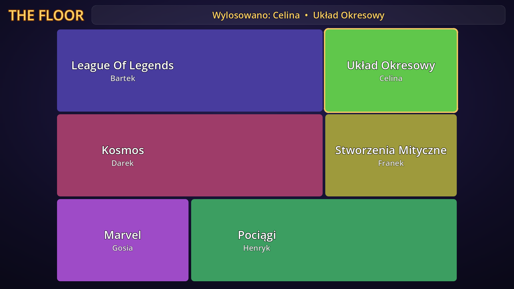

# The Floor – Misiak Edition

Gra imprezowa w stylu teleturnieju *The Floor*, napisana w **Godot 4.7**. Każdy gracz zaczyna z jednym polem i jedną kategorią. Pojedynki toczą się na czas: trzeba szybciej rozpoznawać zdjęcia, utwory, filmy albo odpowiadać na pytania tekstowe. Zwycięzca przejmuje terytorium przegranego, aż cała podłoga należy do jednej osoby.

**📖 Pełna dokumentacja: [misiakpol.github.io/TheFloor-MisiakEdition](https://misiakpol.github.io/TheFloor-MisiakEdition/)**



## Najważniejsze funkcje

- **Dwa okna.** Ekran TV pokazuje grę wszystkim, a konsolę widzi tylko prowadzący. Konsola steruje wszystkim i pokazuje poprawną odpowiedź.
- **Kategorie z plików na dysku:**
  - zdjęcia,
  - muzyka (`.ogg`),
  - wideo (`.ogv`),
  - pytania tekstowe (`.txt`, każda linia `pytanie = odpowiedź`).

  W każdej kategorii z plików nazwa pliku to odpowiedź.
- **Zasady jak w teleturnieju:**
  - ruletka losuje atakującego,
  - pojedynki są na dwa zegary, a pas kosztuje 3 s kary,
  - zwycięzca przejmuje terytorium przegranego,
  - finał gra się do dwóch wygranych rund, z rundą rozstrzygającą z osobnej puli kategorii.
- **Przed grą:**
  - lista graczy na TV,
  - tablica kategorii do wyboru,
  - menedżer kategorii z wykluczaniem z losowania.
- **Dodatki:** statystyki sesji, szybki pojedynek, zapisywane ustawienia i ostry obraz także w 4K.

## Szybki start

1. Zbuduj grę (poniżej) albo pobierz ją z zakładki [Releases](https://github.com/misiakpol/TheFloor-MisiakEdition/releases), jeśli jest tam wydanie.
2. Obok `The Floor.exe` utwórz foldery `kategorie/` i `kategorie final/` i dodaj do nich swoje kategorie, np.:
   ```
   kategorie/
   ├─ Flagi/Polska.png        ← odpowiedź: „Polska”
   ├─ Hity Lat 80/Take On Me - a-ha.ogg
   └─ Matematyka.txt          ← linia: 2+2×2 = 6
   ```
3. Podłącz TV jako drugi ekran w trybie „Rozszerz” i uruchom `The Floor.exe`.

Opis formatów kategorii, prowadzenia gry i rozwiązania typowych problemów jest w [dokumentacji](https://misiakpol.github.io/TheFloor-MisiakEdition/).

## Budowanie

Potrzebujesz Godota 4.7.2 z zainstalowanymi szablonami eksportu. W edytorze wybierz *Projekt → Eksportuj… → Windows Desktop*, albo uruchom w folderze projektu:

```
godot --headless --path . --export-release "Windows Desktop" "The Floor.exe"
```

Foldery `kategorie/`, `kategorie final/` i `audio/music/win/` nie trafiają do `.pck`. Gra czyta je z folderu, w którym leży `.exe`.

## Dla twórców

Architekturę, zasady, pułapki i sposób testowania opisuje [CLAUDE.md](CLAUDE.md). W skrócie:

```
AdminWindow --(metody)--> GameManager --(sygnały)--> Main / DuelScreen / AdminWindow / StatsManager
```

Strona dokumentacji to statyczny plik [docs/index.html](docs/index.html), publikowany przez GitHub Pages z folderu `docs/`.

---

Fanowski projekt do grania ze znajomymi, niezwiązany z twórcami ani właścicielami formatu telewizyjnego „The Floor”.
